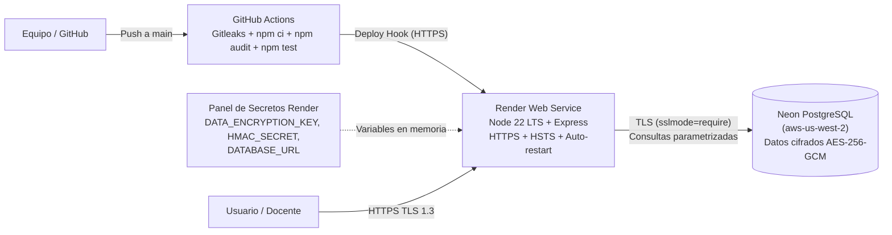

# Fase 0 — Deep Research: Despliegue de Aplicaciones Node.js en Producción

**Proyecto:** SecureVault (Node.js + Express + PostgreSQL)  
**Alcance:** Investigación técnica sobre modelos de despliegue, plataformas gestionadas, seguridad en tránsito y reposo, automatización CI/CD y verificación posterior al despliegue.

---

## 1. Resumen Ejecutivo

Publicar una aplicación Node.js en producción exige mucho más que ejecutar `node server.js` en un equipo local. Un entorno productivo debe garantizar disponibilidad continua, confidencialidad de credenciales y datos en tránsito mediante TLS 1.2/1.3, aislamiento de la base de datos, manejo seguro de errores, observabilidad estructurada y despliegues reproducibles. Tras contrastar tres modelos principales de infraestructura —Platform as a Service (PaaS), contenedores (Docker) y servidores virtuales privados (VPS/IaaS)— se concluye que, para equipos pequeños con foco en seguridad de aplicación, un **PaaS moderno respaldado por contenedores estándar y una base de datos PostgreSQL gestionada con TLS obligatorio** ofrece la mejor relación entre seguridad operativa, velocidad de entrega y costo nulo en capas gratuitas [1][2][4].

En particular, nuestra comparación de **Render**, **Railway** y **Fly.io** muestra que cada proveedor impone compromisos distintos en suspensión por inactividad, créditos mensuales y persistencia de bases de datos. Mientras Render ofrece 750 horas/mes gratuitas para servicios web con HTTPS automático, su base de datos PostgreSQL gratuita expira a los 30 días [1]. Por ello, el plan propuesto para **SecureVault** combina **Render Web Service en runtime nativo Node.js 22** (con despliegue reproducible vía `render.yaml`) con **Neon PostgreSQL gestionado** (capa gratuita permanente con 1 GB y cifrado TLS obligatorio emitido por ISRG/Let's Encrypt) [1][4], orquestado por un pipeline de **GitHub Actions** que ejecuta escaneo de secretos, `npm ci`, `npm audit` y pruebas automatizadas antes de publicar [7][10].

---

## 2. Respuestas Técnicas con Fuentes Verificadas

### 2.1 PaaS vs. Contenedores (Docker) vs. VPS/IaaS

| Criterio | PaaS (Render, Railway, Fly.io, Heroku) | Contenedores (Docker / Cloud Run / ECS / Fly) | VPS / IaaS (AWS EC2, DigitalOcean, Azure VM) |
|---|---|---|---|
| **Nivel de control** | Bajo–medio: la plataforma gestiona SO, parches, red, TLS y proxy inverso [1][2]. | Alto sobre el entorno de ejecución (versión exacta de Node, librerías del sistema, usuario no-root) [8]. | Total: acceso root al SO, firewall (`ufw`/Security Groups), kernel, Nginx, certbot y PM2/systemd. |
| **Ventajas** | Despliegue en minutos desde Git, HTTPS automático, reinicio ante fallos y panel de secretos integrado [1][2]. | Portabilidad total entre local y nube ("funciona igual en todos lados"), aislamiento de procesos, builds reproducibles [8]. | Máxima flexibilidad de red (VPC privadas, reglas IP), costos predecibles a escala y sin suspensión por inactividad. |
| **Desventajas** | Límites en planes gratuitos (sleep por inactividad, sistema de archivos efímero), menor control de red. | Requiere diseñar imágenes seguras (multietapa, usuario no-root, actualización de imagen base) [8]. | Mayor carga operativa y superficie de error humano: si no se parchea el SO o Nginx, el riesgo recae en el equipo. |
| **Costos típicos** | Planes gratuitos/hobby desde \$0 a \$5–\$7 USD/mes [1][2][3]. | Pago por uso por segundo (p. ej. Fly Machines desde ~\$2.19/mes o \$0 dentro del crédito gratuito) [3]. | Desde ~\$4–\$6 USD/mes (Droplet/Lightsail/EC2 t3.micro) más tiempo de administración. |

### 2.2 Comparativa de tres plataformas con plan gratuito o educativo vigente

| Característica | **Render (Free Tier)** [1] | **Railway (Trial + Free Plan)** [2] | **Fly.io (Free Plan)** [3] |
|---|---|---|---|
| **Límites del plan gratuito** | 750 horas de instancia/mes por workspace (servicios web gratuitos); disco local efímero. | Trial inicial de 30 días con \$5 USD de crédito (sin tarjeta); luego Plan Free permanente con \$1 USD/mes, máx. 1 proyecto, 3 servicios, 1 vCPU y 0.5 GB RAM por servicio. | Plan Free con \$5 USD de uso mensual (requiere tarjeta de crédito); hasta 3 Fly Machines, 1 usuario y volúmenes de hasta 5 GB. |
| **¿Duerme por inactividad?** | **Sí:** se suspende tras **15 minutos** sin tráfico entrante; el arranque en frío toma ~1 minuto. | **Sí (Plan Free):** modo serverless que duerme tras **5–10 minutos** sin tráfico saliente y despierta automáticamente ante nuevas solicitudes. (Plan Hobby \$5/mes es always-on). | **Configurable:** soporta `auto_stop` / `auto_start` en máquinas (solo cobra almacenamiento rootfs \$0.15/GB/mes mientras está detenida); Postgres Dev pausa tras 15 min. |
| **Soporte de bases de datos** | PostgreSQL gestionado gratis de 1 GB, pero **expira a los 30 días** (+14 días de gracia) sin backups automáticos. | PostgreSQL/MySQL/Redis/Mongo en el mismo proyecto (0.5 GB volumen en Free; despierta al conectar). | Managed Postgres plan Development (\$4/mes dentro de crédito, 5 GB, auto-pause tras 15 min). |
| **HTTPS automático** | **Sí:** certificados TLS gestionados y renovación automática con redirección HTTP→HTTPS. | **Sí:** TLS automático en subdominios `*.up.railway.app` y dominios personalizados. | **Sí:** Anycast edge con certificados Let's Encrypt automáticos y HTTP→HTTPS forzado. |
| **Regiones disponibles** | Oregon (US), Ohio (US), Virginia (US), Frankfurt (EU), Singapur (APAC). | US West, US East, Europa Occidental, Sudeste Asiático. | Más de 30 regiones globales (base más económica en `iad` Virginia y `ewr` New Jersey; precios variables por región). |

### 2.3 Gestión de variables de entorno y secretos en producción

Un archivo `.env` sirve únicamente para comodidad local durante el desarrollo y **no basta en producción** por cuatro razones [6][9]: (1) riesgo alto de filtración accidental en el historial de Git; (2) ausencia de auditoría de accesos y control granular (RBAC); (3) dificultad para rotar llaves sin reconstruir artefactos o copiar archivos manualmente entre réplicas; y (4) exposición en texto plano dentro del sistema de archivos del servidor o backups.

En producción se utiliza un **gestor de secretos** (como los paneles cifrados de variables secretas de Render/Railway/Fly.io, AWS Secrets Manager, Google Cloud Secret Manager o HashiCorp Vault) que almacena las llaves cifradas en reposo, las inyecta únicamente en memoria mediante variables de entorno del proceso al iniciar, registra quién accede o modifica cada secreto y facilita la rotación periódica sin exponer credenciales en el código fuente [6][9].

### 2.4 Certificados TLS, Let's Encrypt y HSTS

Un **certificado TLS (X.509)** vincula criptográficamente una clave pública con uno o más nombres de dominio y está firmado por una Autoridad Certificadora (CA) reconocida por los navegadores. Durante el *TLS handshake* (TLS 1.2/1.3) permite autenticar al servidor y negociar claves de sesión efímeras con *Forward Secrecy*, protegiendo credenciales, cookies y notas contra escuchas y ataques *Man-in-the-Middle* (MitM) [5][12].

**Let's Encrypt** es una CA gratuita, abierta y automatizada que utiliza el protocolo **ACME (RFC 8555)** [5]. El servidor o plataforma demuestra control del dominio mediante retos automáticos (`HTTP-01` sirviendo un token en `/.well-known/acme-challenge/` o `DNS-01` creando un registro TXT), recibe un certificado de corta duración (90 días) y lo renueva automáticamente antes de vencer, eliminando fallos humanos de expiración [5].

**HSTS (`Strict-Transport-Security`)** es una cabecera HTTP (p. ej. `max-age=31536000; includeSubDomains; preload`) que instruye al navegador a comunicarse **exclusivamente por HTTPS** durante el periodo indicado, bloqueando ataques de degradación de protocolo (*SSL stripping*) y evitando que la primera petición viaje en texto claro [9][11].

### 2.5 Proxy inverso y `trust proxy` en Express

Un **proxy inverso** (como **Nginx**, **Caddy** o la capa *edge* de Render/Cloudflare) se ubica entre Internet y el proceso Node.js [7]. Se utiliza para: (1) terminación TLS (descarga criptográfica y gestión automática de certificados con ACME en Caddy/Nginx); (2) protección frente a conexiones lentas (*Slowloris*), compresión HTTP/2-HTTP/3 y balanceo de carga entre múltiples instancias; y (3) aislamiento del puerto interno de Node.js para no ejecutarlo con privilegios root en los puertos 80/443 [7][8].

En **Express**, cuando existe un proxy inverso delante, todas las conexiones TCP llegan desde la IP local del proxy en HTTP interno, mientras el proxy reenvía la IP real y el protocolo original en las cabeceras `X-Forwarded-For` y `X-Forwarded-Proto`. Configurar `app.set('trust proxy', 1)` indica a Express que confíe exactamente en **un salto de proxy** [7]. Sin esta configuración, `req.secure` sería `false` (rompiendo cookies `Secure` y redirecciones HTTPS) y `req.ip` sería siempre la IP del proxy (haciendo que `express-rate-limit` bloquee a todos los usuarios por igual). Usar `trust proxy: true` sin acotar saltos también es peligroso porque permite falsificar `X-Forwarded-For` y evadir rate limiting [7].

### 2.6 Gestores de procesos (PM2, systemd) vs. Contenedores y PaaS

En un **VPS/IaaS**, un proceso `node src/server.js` muere definitivamente ante una excepción no controlada o un reinicio del servidor. Gestores de procesos como **PM2** o **systemd** supervisan el demonio, lo reinician automáticamente ante fallos, gestionan logs, arrancan el servicio con el sistema operativo y (en el caso de PM2) permiten modo clúster multi-núcleo.

Sin embargo, en **contenedores (Docker/Kubernetes)** y **PaaS (Render/Railway/Fly)** un gestor interno como PM2 suele **dejar de ser necesario** e incluso es una mala práctica [8]: el contenedor debe ejecutar un único proceso principal (`CMD ["node", "src/server.js"]`) que reciba directamente las señales `SIGTERM`/`SIGINT` para un apagado ordenado (*graceful shutdown*), mientras la plataforma u orquestador asume el reinicio automático mediante *health checks* (`/health`), escalado horizontal y recolección de logs desde `stdout/stderr` [8].

### 2.7 CI/CD y pipeline mínimo con GitHub Actions

**Integración Continua (CI)** automatiza la construcción, análisis de seguridad y ejecución de pruebas en cada cambio del repositorio; **Despliegue Continuo (CD)** publica automáticamente en producción solo las versiones que superan todas las puertas de calidad [10]. Un pipeline mínimo seguro en **GitHub Actions** incluye cuatro etapas encadenadas:
1. **Escaneo de secretos** (`gitleaks`) sobre el historial para impedir fuga de llaves.
2. **Instalación reproducible** con `npm ci` (respeta estrictamente `package-lock.json`, a diferencia de `npm install`) [6].
3. **Auditoría y pruebas:** `npm audit --audit-level=high` (OWASP A03) + `npm test` (pruebas funcionales y de seguridad).
4. **Despliegue:** job condicional solo en rama `main` tras pasar CI, invocando el *Deploy Hook* guardado en GitHub Secrets [10].

### 2.8 Bases de datos gestionadas y aseguramiento de conexiones

Entre las principales opciones gestionadas con plan gratuito destacan:
- **Neon (PostgreSQL serverless):** capa gratuita permanente con 1 GB por proyecto, 100 CU-hours/mes, *scale-to-zero* tras 5 min, 8 regiones AWS y **TLS obligatorio** respaldado por Let's Encrypt ISRG Root X1 [4].
- **Supabase (PostgreSQL):** 500 MB en plan gratuito, pausado tras 7 días de inactividad, TLS y soporte de *Row Level Security*.
- **MongoDB Atlas (NoSQL):** clúster compartido M0 gratuito de 512 MB, TLS obligatorio y listas de acceso IP (*IP Access List*) habilitadas por defecto.

Para asegurar la conexión a cualquier base de datos gestionada se aplican cuatro controles [4][9]: (1) **TLS obligatorio** (`sslmode=require` / `verify-full` y `rejectUnauthorized: true`); (2) **restricción de red** (VPC privada o listas de IP permitidas cuando el proveedor de cómputo ofrece IPs estáticas de salida); (3) **principio de mínimo privilegio** (usuario SQL exclusivo para la aplicación sin privilegios `SUPERUSER` ni `DROP DATABASE`); y (4) **timeouts estrictos** de conexión y consulta (`statement_timeout`) para prevenir agotamiento del pool (OWASP A10).

### 2.9 Diferencias clave entre Desarrollo y Producción en Node.js

| Dimensión | Desarrollo (`NODE_ENV=development`) | Producción (`NODE_ENV=production`) |
|---|---|---|
| **Rendimiento / Express** | Sin caché de vistas; mensajes detallados para depuración [7]. | Caché interno optimizado en Express; desactivación de `X-Powered-By` y sin rutas de debug [7]. |
| **Logs** | Legibles en consola local; nivel `debug/info`. | **JSON estructurado** (`pino`) a `stdout` con redacción estricta de contraseñas, tokens y datos cifrados (A09) [6]. |
| **Manejo de errores** | Puede mostrar mensajes diagnósticos locales. | **Respuestas genéricas** con `requestId` al cliente; stack trace solo en logs internos; fail-closed ante errores fatales (A10) [7][9]. |
| **CORS** | `http://localhost:3000`. | Lista blanca estricta del dominio HTTPS de producción (nunca `*` con credenciales) [9]. |
| **Cookies y Transporte** | `COOKIE_SECURE=false` en `localhost` HTTP. | `COOKIE_SECURE=true`, `HttpOnly`, `SameSite=Strict`, redirección 301 HTTP→HTTPS y cabecera HSTS [7][9]. |

### 2.10 Verificaciones de seguridad posteriores al despliegue

Tras publicar la URL de producción, se deben ejecutar verificaciones activas y pasivas únicamente sobre la aplicación propia [11][12]:
- **Cabeceras HTTP:** [securityheaders.com](https://securityheaders.com) y Mozilla Observatory (meta: calificación **A o superior**, verificando CSP, HSTS, `X-Frame-Options`, `X-Content-Type-Options`, `Referrer-Policy` y `Permissions-Policy`).
- **Configuración TLS:** [Qualys SSL Labs](https://www.ssllabs.com/ssltest/) (meta: **A / A+**, TLS 1.2/1.3, sin protocolos obsoletos SSLv3/TLS 1.0/1.1) [12].
- **Escaneo DAST:** **OWASP ZAP Baseline Scan** (`zaproxy.org`) contra la URL pública para detectar hallazgos de configuración, cookies sin flags o fugas de información [11].
- **Cadena de suministro:** `npm audit --audit-level=high` (0 vulnerabilidades altas/críticas) [6].
- **Pruebas manuales/automatizadas de seguridad:** verificación de IDOR (usuario A intentando leer nota de usuario B → 404), inyección SQL (`' OR 1=1 --` → 400), XSS (`<script>` neutralizado por `textContent` + DOMPurify + CSP), fuerza bruta (HTTP 429) y manejo genérico de errores.

---

## 3. Plan de Despliegue Propuesto para SecureVault

### Plataforma elegida y justificación
Elegimos **Render (Web Service Free Tier)** para la aplicación Node.js + **Neon (Free Tier PostgreSQL)** para la base de datos:
1. **Persistencia sin expiración de 30 días:** evita el límite de expiración de 30 días del PostgreSQL gratuito de Render [1], manteniendo la base de datos disponible durante todo el periodo de evaluación con TLS obligatorio [4].
2. **HTTPS automático y proxy confiable:** Render provisiona certificados TLS y redirige HTTP→HTTPS automáticamente; Express se configura con `TRUST_PROXY=1` y `COOKIE_SECURE=true` [1][7].
3. **Reproducibilidad e infraestructura como código:** el archivo `render.yaml` y el despliegue nativo con `npm ci` + `npm start` permiten recrear o migrar la app a Railway o cualquier PaaS Node.js en minutos sin requerir Docker local ni *vendor lock-in*.
4. **Cero costo y cero tarjeta obligatoria** para cuentas estudiantiles.

### Arquitectura de despliegue

---

## 4. Lista de Referencias

1. **Render Official Documentation** — *Free Tier, Spin-Down Behavior, Free PostgreSQL Expiration & Regions*: https://render.com/docs/free y https://render.com/docs/regions
2. **Railway Official Documentation** — *Pricing Plans, Free Tier Limits & Serverless App Sleeping*: https://docs.railway.com/reference/pricing/plans
3. **Fly.io Official Documentation** — *Pricing, Auto-Stop Machines & Managed Postgres*: https://fly.io/docs/about/pricing/
4. **Neon Official Documentation** — *Free Plan Limits, TLS/SSL Connections & Supported Regions*: https://neon.com/docs/introduction/plans y https://neon.com/docs/connect/connect-securely
5. **Let's Encrypt Official Documentation** — *How It Works (ACME Protocol)*: https://letsencrypt.org/how-it-works/
6. **Node.js Official Security Best Practices**: https://nodejs.org/en/learn/getting-started/security-best-practices y **Node.js `crypto` API**: https://nodejs.org/api/crypto.html
7. **Express Official Documentation** — *Security Best Practices in Production & Express behind Proxies (`trust proxy`)*: https://expressjs.com/en/advanced/best-practice-security.html y https://expressjs.com/en/guide/behind-proxies.html
8. **OWASP Cheat Sheet Series** — *Node.js Docker Cheat Sheet & Node.js Security Cheat Sheet*: https://cheatsheetseries.owasp.org/cheatsheets/Nodejs_Docker_Cheat_Sheet.html
9. **OWASP Top 10:2025** & **OWASP Password/Cryptographic Storage Cheat Sheets**: https://owasp.org/Top10/2025/ y https://cheatsheetseries.owasp.org/
10. **GitHub Actions Official Documentation** — *Security Hardening & Node.js CI*: https://docs.github.com/en/actions/security-for-github-actions
11. **OWASP ZAP (Zed Attack Proxy)** — *Baseline Scan Documentation*: https://www.zaproxy.org/docs/docker/baseline-scan/
12. **Qualys SSL Labs** — *SSL Server Rating Guide*: https://www.ssllabs.com/ssltest/
