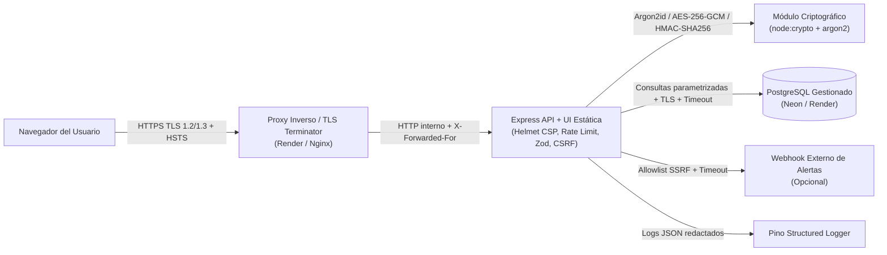
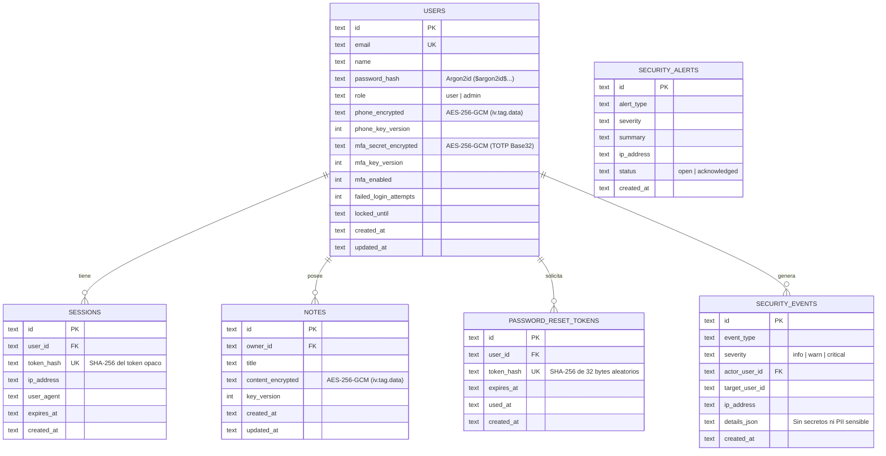
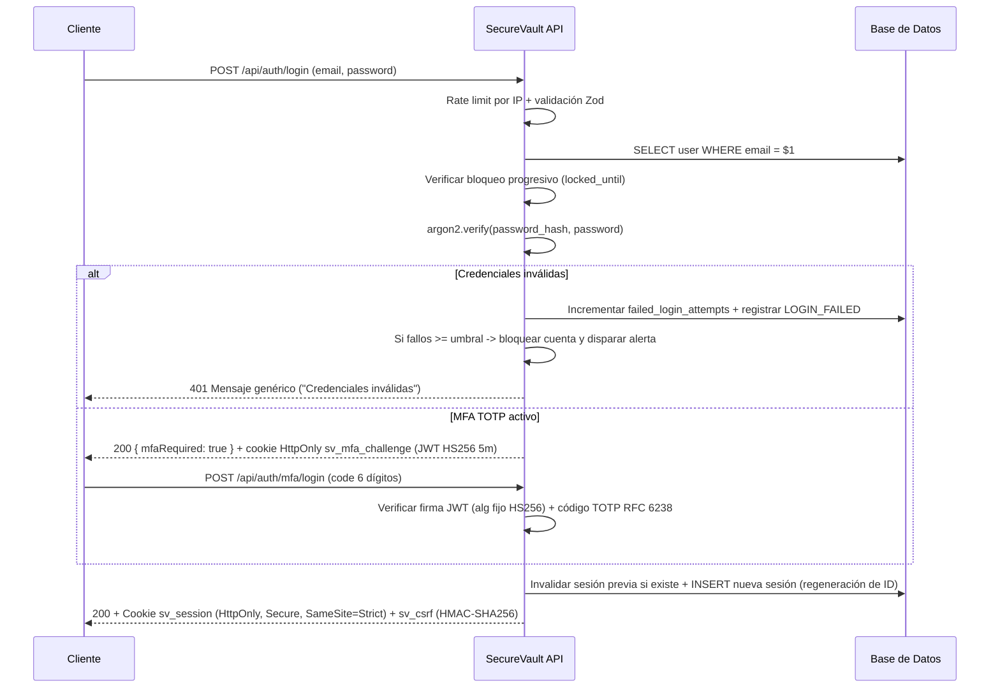

# Fase 1 — Diseño de Arquitectura y Modelo de Amenazas (OWASP A06:2025)

## 1. Arquitectura de SecureVault

## 2. Modelo de Datos

## 3. Flujo de Autenticación y Sesiones

## 4. Modelo de Amenazas STRIDE y Mitigaciones

| ID | Categoría STRIDE | Amenaza / Caso de abuso | Categoría OWASP 2025 | Mitigación implementada en SecureVault |
|---|---|---|---|---|
| T-01 | **S**poofing | Fuerza bruta o credential stuffing contra el login para suplantar usuarios o administradores. | A07 Authentication Failures | Rate limiting por IP (`express-rate-limit`), bloqueo progresivo de cuenta (`locked_until`), Argon2id (19 MiB), respuestas genéricas sin enumeración y MFA TOTP opcional. |
| T-02 | **S**poofing | Fijación de sesión (Session Fixation) o robo de cookie por XSS/HTTP en claro. | A07 / A04 / A02 | Regeneración de ID de sesión al autenticar, cookie `HttpOnly`, `Secure`, `SameSite=Strict`, expiración corta (2 h), TLS obligatorio + HSTS y CSP estricta sin inline scripts. |
| T-03 | **T**ampering | Alteración de notas cifradas o de tokens firmados (JWT/CSRF) en tránsito o en la base de datos. | A04 / A08 | Cifrado autenticado AES-256-GCM (tag de 16 bytes detecta manipulación), verificación de firmas HMAC-SHA256 y JWT con algoritmo fijo `HS256` (`timingSafeEqual`), validación estricta Zod. |
| T-04 | **T**ampering | Inyección SQL en consultas o XSS almacenado en títulos/contenido de notas. | A05 Injection | 100 % consultas parametrizadas (`$1, $2`), validación con esquemas Zod, renderizado seguro con `textContent` + DOMPurify con SRI, y cabecera CSP que bloquea scripts inline. |
| T-05 | **R**epudiation | Un atacante intenta acceder a recursos ajenos o un administrador cambia roles sin dejar rastro auditable. | A09 Security Logging & Alerting | Bitácora estructurada en JSON (`pino`) y persistida en `security_events` para logins, accesos denegados, intentos IDOR, revelación de PII, rotación de llaves y cambios de rol, con alertas automáticas. |
| T-06 | **I**nformation Disclosure | Acceso horizontal (IDOR) donde el usuario A intenta leer, modificar o eliminar una nota del usuario B. | A01 Broken Access Control | Filtrado obligatorio por propietario en todas las consultas (`WHERE id = $1 AND owner_id = $2`), registro de `IDOR_ATTEMPT` y respuesta 404/403 sin revelar existencia. |
| T-07 | **I**nformation Disclosure | Compromiso de respaldo de BD exponiendo contraseñas, notas privadas, teléfonos o tokens de recuperación. | A04 Cryptographic Failures | Contraseñas con Argon2id, notas y teléfonos con AES-256-GCM (IV aleatorio único de 12 bytes), tokens de recuperación/sesión guardados únicamente como hash SHA-256, llaves fuera del repositorio. |
| T-08 | **I**nformation Disclosure | Exfiltración de stack traces, versiones de Node/Express o metadatos internos ante errores o en `/health`. | A02 / A10 | `X-Powered-By` desactivado, manejador global de errores con respuestas genéricas (`INTERNAL_ERROR` + `requestId`), `/health` minimalista (`{ "status": "ok" }`), `NODE_ENV=production`. |
| T-09 | **D**enial of Service | Agotamiento de almacenamiento o CPU creando miles de notas gigantes o provocando consultas colgadas. | A06 / A10 | Límites de negocio (máx. 50 notas por usuario, título ≤ 150 chars, contenido ≤ 10 000 chars), límite de cuerpo JSON (`32kb`), rate limiting global y de auth, timeouts en BD y peticiones salientes. |
| T-10 | **E**levation of Privilege | Escalación de `user` a `admin` mediante mass assignment en registro/perfil o abuso de rutas administrativas. | A01 Broken Access Control | Validación estricta Zod que rechaza/ignora `role` en endpoints públicos, verificación de rol en BD en cada petición (`requireRole('admin')`), principio de denegar por defecto. |
| T-11 | **S**poofing / **I**nfo Disclosure (SSRF) | Abuso del webhook de alertas salientes para escanear red interna o metadatos cloud (`169.254.169.254`). | A01 Broken Access Control (SSRF) | Validación estricta de URL HTTPS, lista blanca de dominios (`ALLOWED_WEBHOOK_HOSTS`), resolución DNS con bloqueo de rangos IPv4/IPv6 privados/loopback/link-local y deshabilitación de redirecciones inseguras. |

## 5. Casos de Abuso Documentados y Límites de Negocio

1. **Abuso de cuota de notas (Storage Exhaustion):** Un usuario intenta crear >50 notas o notas de 5 MB. *Control:* `MAX_NOTES_PER_USER=50`, `MAX_NOTE_CONTENT_LENGTH=10000`, `express.json({ limit: '32kb' })`.
2. **Enumeración de cuentas en registro/login/recuperación:** Un atacante prueba correos para saber cuáles están registrados. *Control:* Login devuelve siempre `"Credenciales inválidas"`; recuperación de contraseña devuelve siempre `200` con mensaje genérico independientemente de si el correo existe.
3. **Reutilización de token de recuperación:** Un atacante intercepta y reusa un token ya utilizado o expirado. *Control:* Expiración de 15 minutos, marcado atómico `used_at`, invalidación de todas las sesiones activas tras cambio de contraseña.
4. **Degradación de integridad de secretos en repositorio:** Un desarrollador intenta subir `.env` o llaves hardcodeadas. *Control:* `.gitignore`, validación de arranque fail-closed si faltan llaves válidas, y escaneo automático con `gitleaks` en GitHub Actions.
